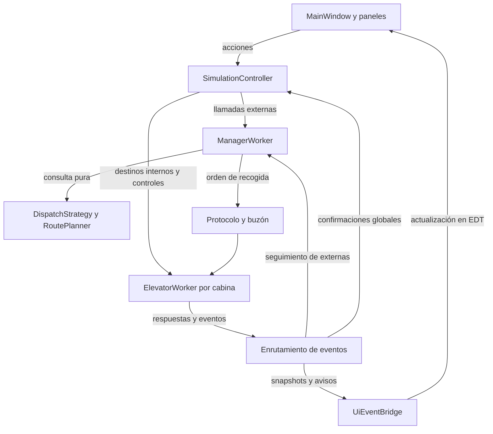

# 03 — Arquitectura del sistema

- **Proyecto:** Elevator Manager.
- **Versión:** 0.2.0.
- **Fecha:** 2026-10-20, Guatemala.
- **Estado:** arquitectura actualizada para T12; entrada y ventana mínima validadas en T11, motor y contratos pendientes de implementación.
- **Base:** [01 — Plan](01-analisis-y-plan.md) y [02 — Decisiones](02-decisiones.md).

## 1. Objetivos y límites

Separar presentación, ciclo de vida, asignación y movimiento. Asegurar N cabinas independientes y un manejador independiente, sin ejecutar esperas en Swing. El dominio se puede probar sin abrir ventanas. La comunicación textual y la temporización pausable son contratos previstos desde el diseño, aunque sus extras se completen después de la versión base.

Una sola JVM contiene el programa. No se agregan servidor, base de datos, comunicación de red ni procesos externos. «Independiente» significa trabajador con estado y cola propios, no aislamiento de memoria entre procesos.

## 2. Estructura física prevista

```text
elevator-manager/
  pom.xml
  README.md
  .gitignore
  docs/
    01-analisis-y-plan.md
    02-decisiones.md
    03-arquitectura.md
    04-algoritmo-asignacion.md
    05-protocolo.md
    06-pruebas.md
  src/
    main/
      java/com/elevatormanager/
        app/
        model/request/
        simulation/
        dispatch/
        protocol/
        io/
        logging/
        ui/
      resources/
    test/
      java/com/elevatormanager/
        model/
        simulation/
        dispatch/
        protocol/
        io/
      resources/requests/
  examples/requests/
  evidence/
  logs/
  target/
```

Los documentos iniciales `docs/01`..`06` se conservan. T10 materializó los paquetes, recursos, ejemplos, pruebas y evidencias; T11 añadió la ventana mínima. Las clases funcionales restantes representan el diseño futuro. `07-manual-usuario.md` y `08-evidencias.md` se agregarán conforme exista comportamiento verificable. `target/` y los registros generados se excluyen del control de versiones.

## 3. Componentes y dependencias

| Paquete | Tipos previstos | Responsabilidad y dependencia |
| --- | --- | --- |
| `app` | `ElevatorManager` | Entrada `main`; crea configuración, composición de objetos y ventana en EDT. |
| `model` | `SimulationConfig`, `ElevatorState`, `ElevatorSnapshot`, `Direction`, `ElevatorPhase`, `RoutePlan` | Datos e invariantes; no conoce Swing ni archivos. |
| `model.request` | `Request`, `HallRequest`, `CabinRequest` | Solicitudes con herencia funcional. |
| `simulation` | `SimulationController`, `ManagerWorker`, `ElevatorWorker`, `SimulationClock` | Ciclo de vida, propiedad del estado y ejecución concurrente. Depende del dominio, estrategia y canales. |
| `dispatch` | `DispatchStrategy`, `EstimatedTimeDispatchStrategy`, `RoutePlanner`, `PickupEstimate` | Proyección pura del recorrido y selección; sin esperas ni escritura en cabinas. |
| `protocol` | `Command`, `MessageCodec`, `MessageParser`, `ElevatorMailbox`, `WorkerEvent` | Frontera textual, validación sintáctica y transporte en memoria. |
| `io` | `RequestFileReader`, `PreparedRequestBatch` | Leer/validar texto; producir lote inmutable antes de confirmar. |
| `logging` | `LoggerFactory`, `EventFormatter` | Handlers de archivo/terminal y eventos legibles; adaptador visual en `ui`. |
| `ui` | `MainWindow`, `ConfigurationDialog`, `ControlPanel`, `ElevatorPanel`, `BuildingPanel`, `UiEventBridge` | Entradas y vistas; depende de controlador/snapshots, nunca de colecciones internas de trabajadores. |

Los nombres son compromisos de diseño orientativos, salvo `ElevatorManager`, que lo exige el enunciado. Si se renombran tipos durante el desarrollo, actualizar este documento.

## 4. Herencia y polimorfismo previstos

`Request` es una clase abstracta con identidad, época, piso y fecha. Define la operación de validación contra un contexto de configuración y la descripción de la solicitud.

| Subtipo | Datos adicionales | Especialización |
| --- | --- | --- |
| `HallRequest` | Dirección deseada. | Valida sentido posible en el piso; describe una recogida compartida, sin ID de cabina elegido por usuario. |
| `CabinRequest` | ID de cabina. | Valida que exista cabina; describe un destino interno sin sentido externo. |

El importador y el controlador manejan una colección de `Request` y ejecutan el comportamiento especializado mediante referencias de tipo base. El enrutamiento al manejador o a una cabina conserva el tipo concreto. La aceptación exige demostrar que ambos subtipos se usan; una interfaz de estrategia o heredar de `JFrame` no serán la única justificación de herencia del proyecto.

## 5. Hilos, propiedad y canales

| Ejecutor | Qué hace | Qué no puede hacer |
| --- | --- | --- |
| EDT de Swing | Lee formularios, actualiza componentes, dibuja animación con snapshots. | Esperar movimiento, leer grandes archivos, esperar `join` o confirmaciones. |
| Coordinación del controlador | Serializa acciones de ciclo de vida y confirmaciones globales. Puede usar un ejecutor único con cola. | Modificar directamente la agenda de una cabina. |
| `manager-worker` | Consume externas, estima, asigna y sigue sus eventos. | Dormir hasta que termine un viaje o editar el estado de una cabina. |
| `elevator-worker-ID` | Único escritor del estado/agenda de esa cabina; consume controles y servicio. | Actualizar Swing o esperar respuestas de otro trabajador sosteniendo su bloqueo. |
| Ejecutor de I/O | Lee archivo y produce lote validado; entrega resultado al controlador. | Confirmar importación sin revalidar RESET/época. |

Se permiten los ejecutores de coordinación/I/O auxiliares; los hilos exigidos son el manejador y los N trabajadores de cabinas. Se crean una vez por sesión; Start/Stop no los duplica.

**Canales previstos:** cola de externas al manejador; buzón por cabina con prioridad de control y entrada de servicio; canal de respuestas hacia el coordinador/manejador. Una respuesta se enruta al propietario de su seguimiento, no se consume por dos lectores compitiendo sobre una sola cola.

**Escritura única:** un snapshot contiene revisión creciente, época, piso, siguiente piso, dirección, fase, progreso/tiempo restante, frontera comprometida y copias inmutables de destinos y llamadas. Su publicación debe ser atómica. El registro global de admisiones se protege en el controlador; la agenda concreta pertenece a su cabina.

## 6. Modelo de estado por cabina

| Campo | Regla |
| --- | --- |
| `id` | Único, entre 1 y N durante la sesión. |
| `epoch` | Generación activa del sistema. |
| `revision` | Aumenta con cambios observables; permite detectar proyecciones obsoletas. |
| `currentFloor` | Último piso alcanzado/dejado; cambia solo al completar un tramo. |
| `nextFloor` | Piso adyacente durante tránsito; ausente estando alineada con un piso. |
| `direction` | UP/DOWN; UP al inicio y tras reset. |
| `phase` | IDLE, MOVING, DWELLING, HELD o TERMINATED; HELD conserva fase suspendida. |
| `remainingDuration` | Restante monotónico de tramo/parada; congelado al pausar. |
| `routePlan` | Solicitudes internas/externas, barrido comprometido y trabajos diferidos. |
| `mode` | Servicio normal o retorno por reset; estado global restringe avance. |

El trabajador gestiona comandos durante la espera temporal. No basta un `sleep` largo que impida reaccionar a controles; debe poder despertar, recalcular restante y volver a esperar.

## 7. Flujos principales

### 7.1 Llamada externa

1. GUI valida campos básicos; controlador comprueba RUNNING, límites y duplicado funcional.
2. Manejador recibe solicitud, toma snapshots y usa la estrategia de 04.
3. Emite mensaje textual de recogida con época e identidad; cabina valida y responde.
4. Manejador registra asignación al recibir aceptación. No la declara atendida aún.
5. Cabina incorpora solicitud a agenda, se desplaza y comienza una parada compatible.
6. Emite finalización correlacionada; manejador cierra la externa y la vista actualiza pendientes.

### 7.2 Selección interna

GUI/controlador validan ID/piso y envían destino al buzón de esa cabina; no necesitan seleccionar otra. La cabina enciende el destino cuando lo admite. Al iniciar su servicio lo retira de pendientes y notifica finalización. Hasta que exista ese evento, un ACK no apaga el indicador.

### 7.3 Importación

El controlador captura estado/época RESET y encarga lectura. El lector valida todo a una lista de solicitudes sin ejecutar nada. Antes de sustituir el lote, el controlador vuelve a verificar RESET y misma época. Start entrega las entradas al flujo normal en orden; los hilos se ejecutan concurrentemente y el orden de finalización no está garantizado por el orden del archivo.

### 7.4 Reset global

1. Controlador bloquea nuevas admisiones y pasa a RESETTING; incrementa época.
2. Invalida lote preparado, externas viejas y envíos pendientes; emite reset prioritario a cada cabina.
3. Cada cabina adopta época nueva, descarta agenda antigua y despierta si estaba suspendida.
4. Completa tramo físico parcial si existe; retorna a 1 sin paradas de servicio.
5. Publica piso 1/UP y confirmación terminal de reset.
6. Solo cuando todos confirman, el controlador publica RESET. Respuestas de épocas previas no cambian ese estado.

### 7.5 Cierre y fallos

Cerrar cancela avance, despierta trabajadores, espera su terminación fuera del EDT, cierra handlers y finalmente publica CLOSED. Un timeout de supervisión se informa como incidencia, no como éxito. Una cabina fallida se marca no disponible; no se reasigna automáticamente una solicitud que pudiera haber sido atendida sin confirmación.

## 8. Logs y presentación

Cada transición física relevante genera un evento estructurado. Sus consumidores construyen archivo por cabina, terminal y vista gráfica acotada. Registrar origen/destino en MOVE_STARTED, piso en ARRIVED, solicitudes atendidas en STOP_STARTED, dirección anterior/nueva en DIRECTION_CHANGED y comienzo/final del reset. Al atender destinos, log y snapshot deben corresponder al mismo cambio de dominio.

La animación interpola progreso publicado y tiempo monotónico únicamente mientras RUNNING o RESETTING lo permitan; no decide cuándo se alcanza un piso. El modelo sigue siendo autoridad. PAUSED congela el progreso; Stop puede continuar el tramo ya iniciado hasta su frontera.

## 9. Contratos de integración y construcción

- `DispatchStrategy`: recibe solicitud y snapshots, devuelve candidato y estimación o causa de ausencia; sin modificar entradas.
- `RoutePlanner`: admite solicitudes válidas, proyecta eventos y genera siguiente acción con las mismas reglas usadas por ETA.
- `SimulationController`: acciones asíncronas de inicio/detención/pausa/reset/cierre; publica estado tras confirmaciones.
- Parser de archivo: devuelve lote completo o errores con línea; no ejecuta solicitudes.
- Parser de protocolo: mensaje válido o error controlado; validación de estado/época se hace en el receptor.
- `SimulationClock`: tiempo monotónico real y alternativa controlada para pruebas; evita acoplar las reglas a esperas reales.
- Construcción actual verificada por el usuario en T11: `mvn clean verify`; artefacto `target/elevator-manager-0.1.0-SNAPSHOT.jar`, manifiesto con `com.elevatormanager.app.ElevatorManager` y objetivo Java 17. La versión final de distribución se fijará al empaquetar la entrega.

## 10. T12 — Componentes y contratos de integración

### 10.1 Alcance y estado comprobado

T12 documenta el flujo GUI → controlador → manejador → elevador → eventos, separa algoritmo y protocolo y asigna un propietario a cada responsabilidad. No añade clases Java ni afirma que el motor esté implementado.

| Elemento | Estado al redactar T12 |
| --- | --- |
| Proyecto Maven y paquetes | Preparados en T08–T10; T10 declarada terminada por el usuario. |
| `app.ElevatorManager` y `ui.MainWindow` | Implementados en T11; compilación, JAR, Run Java, EDT y cierres por botón/X comprobados por el usuario. |
| `diagnostics.EnvironmentCheck` | Comprobación técnica independiente de T09, conservada. |
| Controlador, manejador, cabinas y contratos siguientes | Diseño para implementación posterior. |
| Herencia de solicitudes | Relación prevista en sección 4; detalle en T13 e implementación en T18. |

La aceptación funcional de T11 está confirmada; este documento no presupone que su commit ya exista. El cierre actual con `dispose()` es suficiente para T11. Cuando existan trabajadores, deberá sustituirse por la secuencia coordinada de la sección 7.5.

### 10.2 Flujo y separación de componentes



El diagrama muestra el recorrido operativo, no autoriza referencias mutables compartidas. Controlador y manejador usan el mismo canal de protocolo/buzón para enviar órdenes a una cabina. El canal de vuelta distribuye cada mensaje al destinatario responsable; no hay dos consumidores compitiendo por una misma confirmación.

### 10.3 Propietarios y límites

Todos los nombres de tipos siguientes, excepto los dos ya implementados, son contratos de diseño. Los tipos auxiliares podrán agruparse al implementar; no es necesario crear una clase por cada fila de datos.

| Componente | Propietario de | Puede hacer | No debe hacer |
| --- | --- | --- | --- |
| `ElevatorManager` | Composición de dependencias de una sesión. | Construir estrategia, canales, controlador y vista; conectar sus fronteras. | Asignar llamadas o ejecutar movimiento dentro de `main`. |
| `MainWindow` y paneles | Componentes Swing y valores de formularios. | Solicitar acciones, mostrar respuestas y snapshots. | Modificar cabinas, decidir asignación o esperar confirmaciones. |
| `SimulationController` | Estado global, época, configuración y registro de admisión; lote preparado. | Serializar acciones globales, validar entradas, dirigir internas y coordinar barreras. | Escribir agendas de cabinas o decidir qué externa se atiende físicamente. |
| `ManagerWorker` | Seguimiento operativo de externas: pendientes, envíos y asignaciones. | Consultar snapshots, seleccionar candidata y seguir respuestas. | Mover cabinas, actualizar Swing o declarar atención con solo un ACK. |
| `ElevatorWorker` | Estado mutable, agenda y avance temporal de una cabina. | Admitir comandos válidos, ejecutar recorrido y publicar resultados. | Escribir en otras cabinas o aceptar órdenes de servicio de una época inválida. |
| `DispatchStrategy` | Regla de selección, sin estado mutable de cabinas. | Comparar estimaciones y devolver candidata. | Enviar mensajes, esperar viajes o modificar snapshots. |
| `RoutePlanner` | Reglas del recorrido y proyección de acciones. | Calcular admisión/orden del plan a partir de datos explícitos. | Hacer I/O, dormir o modificar una agenda compartida por referencia. |
| Protocolo y buzones | Sintaxis, correlación y entrega de mensajes. | Codificar, parsear, enviar y despertar al receptor. | Calcular ETA o decidir si el reset físico terminó. |
| `RequestFileReader` | Lectura y diagnóstico de un archivo. | Validar un lote completo o devolver errores por línea. | Mover cabinas, elegir elevador o confirmar el lote global. |
| `UiEventBridge` | Entrega de proyecciones a Swing. | Programar actualizaciones en EDT y descartar revisiones visuales obsoletas. | Convertirse en dueño del estado de simulación. |
| Logging | Formato, handlers, archivos y terminal. | Registrar transiciones y liberar sus recursos al cerrar. | Determinar llegada, atención o éxito de un control. |

El registro de admisión del controlador evita duplicados funcionales y correlaciona respuestas al usuario. El registro del manejador sigue el despacho de externas; la agenda del elevador refleja el trabajo admitido por esa cabina. Son responsabilidades distintas: ninguno puede sobrescribir el estado privado de los otros.

### 10.4 Datos que cruzan las fronteras

| Dato conceptual | Contenido mínimo | Regla |
| --- | --- | --- |
| Configuración | N, P, tiempo entre pisos y tiempo de parada. | Validada e inmutable por sesión. |
| Solicitud | Identidad, época, piso, instante y especialización externa/interna. | Objeto de dominio sin referencias a Swing. El detalle de herencia corresponde a T13. |
| Resultado de admisión | Identidad, época, admitida/duplicada/rechazada y causa. | Admitida significa registrada para procesamiento; no significa asignada ni atendida. Un duplicado devuelve referencia al trabajo ya activo. |
| Orden de cabina | Identidad de mensaje, correlación, época, receptor y argumentos. | Contenido textual conforme a 05; no confundir identidad de transporte con identidad de solicitud. |
| Respuesta de cabina | Mensaje correlacionado, época, cabina, resultado y causa. | Distingue aceptación, rechazo y finalización. ACK no significa servicio realizado. |
| Evento de servicio | Solicitudes efectivamente atendidas, época, cabina, piso e instante. | Se origina al comenzar una parada compatible; no basta llegar al piso. |
| Confirmación de control | Operación, época, emisor y condición alcanzada. | El controlador agrupa confirmaciones de la operación vigente. |
| `ElevatorSnapshot` | ID, época, revisión, piso/siguiente piso, sentido, fase, progreso/restante y copias de pendientes. | Inmutable y publicado atómicamente por cabina. |
| Proyección global | Estado global, época, lote preparado, cabinas e incidencias. | Se construye con snapshots publicados; no promete que todas las cabinas se capturaron en el mismo instante. |
| Lote preparado | Entradas validadas, orden y referencias de línea. | No ejecuta trabajo; solo se confirma en RESET y época vigente. |
| Incidencia | Origen, operación/solicitud si existe, causa y severidad. | Debe ser visible; nunca convertir un fallo o timeout en confirmación de éxito. |

La vista puede omitir snapshots intermedios al refrescar; no se pueden perder confirmaciones ni eventos de servicio por esa optimización. Época y revisión identifican mensajes obsoletos. Los nombres exactos de campos del protocolo se mantienen en 05.

### 10.5 Contratos de operaciones

Las operaciones siguientes son descripciones completas de intención, entradas y resultados; no son firmas Java implementadas.

| Operación / responsable | Entradas y precondiciones | Resultado y garantía |
| --- | --- | --- |
| Crear sesión / composición y controlador | Configuración válida, ninguna sesión activa anterior. | Estado inicial RESET; N cabinas en 1/UP. Un manejador y N trabajadores de cabina por sesión, sin duplicación por Start. |
| Admitir externa / controlador | Piso y dirección posibles; RUNNING. | Resultado asíncrono de admisión; si procede, entrega al manejador con identidad/época. La GUI no selecciona cabina. |
| Admitir interna / controlador | ID existente, piso válido; RUNNING. | Resultado asíncrono y envío a esa cabina; no consulta la estrategia de asignación. |
| Seleccionar cabina / estrategia | Externa válida y snapshots inmutables de disponibles. | Candidata con costo estimado o ausencia justificada; sin efectos laterales. |
| Procesar servicio / cabina | Mensaje sintácticamente válido, época vigente y modo que permita admitirlo. | Acepta o rechaza con correlación; al aceptar actualiza su agenda y publica snapshot. El servicio se confirma después. |
| Importar / lector y controlador | Ruta elegida; RESET capturado con época. | Lector produce lote completo o errores. Controlador revalida estado/época antes de sustituirlo; error o cancelación conserva el lote anterior. |
| Start / controlador | RESET o STOPPED. | Publica ejecución autorizada, entrega lote una sola vez si corresponde y continúa pendientes. Start repetido en RUNNING no crea trabajadores. |
| Stop / controlador | RUNNING; también se admite desde PAUSED según 02. | Operación asíncrona; STOPPED solo tras detener despacho y confirmar cabinas. Conserva pendientes; desde PAUSED conserva el avance congelado. |
| Pausar / controlador | RUNNING. | PAUSING y luego PAUSED tras confirmaciones; congela tiempo/progreso. |
| Reanudar / controlador | PAUSED. | Continúa fases y pendientes desde sus restantes, sin crear trabajadores. |
| Reset / controlador y cabinas | Estado permitido por 02. | Nueva época, invalidación de trabajo viejo y RESET solo tras retorno confirmado de todas las cabinas a 1/UP. Repetir durante RESETTING no crea otra época. |
| Cerrar / controlador | Cualquier estado; repetición segura. | Despierta y termina trabajadores, libera recursos y confirma CLOSED; espera fuera del EDT. No publica CLOSED si faltan terminaciones. |
| Observar / puente de UI | Proyección publicada. | Entrega visual en EDT; el lector no obtiene colecciones internas mutables. |

Las entradas inválidas o acciones incompatibles devuelven rechazo con causa, sin dejar mutaciones parciales. Las acciones asíncronas deben devolver el control inmediatamente al EDT. Una futura finalización de control representa la condición terminal definida, mientras que una futura admisión de solicitud solo representa admisión. Cualquier callback que toque Swing vuelve al EDT; no se presupone el hilo de ejecución de los callbacks.

### 10.6 Contrato de asignación frente a contrato de protocolo

**Asignación:** recibe solicitudes/snapshots de dominio y estima recogida según 04. Considera dirección, recorrido comprometido, distancia y carga; resuelve empates determinísticamente. Si no hay candidata, el manejador mantiene seguimiento pendiente o informa una incidencia conforme a la causa. Una estimación no autoriza por sí sola una mutación posterior.

**Protocolo:** convierte una orden en texto y ese texto en un mensaje validado al recibirlo. Su gramática y respuestas están en 05. El receptor comprueba época, estado y argumentos de dominio aunque la sintaxis sea correcta. El buzón transporta el mensaje y despierta al trabajador; no interpreta disponibilidad física.

**Integración:** el manejador selecciona candidata, emite recogida y espera respuesta sin bloquear la GUI ni el avance de otras cabinas. Un rechazo antes de aceptación permite recalcular. Una externa aceptada no se reasigna en operación normal. Si falta una confirmación, no se supone que el servicio no ocurrió ni se duplica automáticamente la recogida.

Cambiar de estrategia no exige cambiar la gramática; cambiar el codificador no cambia las reglas de movimiento. `DispatchStrategy` no depende de `MessageParser`, y el parser no depende de la estrategia concreta.

### 10.7 Secuencias que definen el contrato

1. **Externa:** GUI → admisión del controlador → pendiente del manejador → selección → orden textual → aceptación de cabina → asignación confirmada → parada compatible → evento de servicio → cierre del seguimiento y actualización visual.
2. **Interna:** GUI → admisión del controlador → orden a la cabina indicada → aceptación y destino encendido → movimiento si corresponde → inicio de parada → destino apagado y evento de servicio. La duración de parada puede seguir transcurriendo después de apagarlo.
3. **Controles:** controlador serializa acción → bloquea admisiones incompatibles → coordina manejador/cabinas → reúne confirmaciones vigentes → publica estado terminal. No acepta como barrera completa únicamente los snapshots visuales.
4. **Importación:** lectura fuera del EDT → validación completa → revalidación RESET/época → sustitución del lote → Start lo libera una vez al flujo normal. Si hubo reset o Start durante la lectura, se rechaza la confirmación tardía.
5. **Observación:** trabajador produce transición y snapshot → canales de seguimiento reciben eventos fiables → puente agenda vista en EDT y logging registra la transición. El orden de finalización entre distintas cabinas no tiene por qué coincidir con el orden de ingreso.

Durante Stop, el manejador confirma que no seguirá despachando y conserva sus pendientes; cada cabina alcanza la frontera segura de 02. Los envíos ya en tránsito se resuelven conservando el trabajo pendiente y sin ejecutar servicio mientras STOPPED. La implementación de prioridades y barreras se concreta en T14.

### 10.8 Dependencias permitidas y aislamiento de Swing

| Paquete | Dependencias de proyecto permitidas por el diseño |
| --- | --- |
| `app` | Componentes necesarios para componer la sesión y `ui`. |
| `ui` | Frontera pública de `simulation`, datos de `model` y sus solicitudes. |
| `simulation` | `model`, contratos de `dispatch`, `protocol`, `io` y logging. Nunca `ui`. |
| `dispatch` | `model` y sus solicitudes; sin Swing, buzones ni estrategia de transporte. |
| `protocol` | Datos de `model` y sus propios mensajes; sin Swing ni algoritmo de asignación. |
| `io` | Configuración y solicitudes de `model`; sin Swing ni control de movimiento. |
| `model` y `model.request` | APIs estándar de datos/tiempo; sin Swing, archivos, transporte ni referencias a trabajadores. |
| `logging` | Java Logging y datos de eventos; sin componentes Swing. El adaptador visual pertenece a `ui`. |

La entrada inyecta callbacks o suscripciones para que el controlador publique sin importar `MainWindow`. Los eventos de transporte siguen perteneciendo a `protocol`; si el dominio debe generar hechos, usa datos propios del modelo y la capa de simulación los adapta. Así se evita hacer depender `model` del protocolo.

`RoutePlan` es dato de modelo y `RoutePlanner` contiene las reglas que operan sobre él. Un plan real solo lo cambia su cabina; la estrategia estima sobre copias/proyecciones. Esto evita dependencias circulares entre `model` y `dispatch`.

### 10.9 Comprobaciones derivadas para implementación posterior

| Caso | Resultado observable exigido |
| --- | --- |
| Dos externas válidas para cabinas distintas | El manejador despacha y ambas cabinas avanzan de forma independiente. |
| Mensaje aceptado antes de llegar al piso | Aparece como asignado/pendiente; todavía no como atendido. |
| Llamadas UP y DOWN en el mismo piso | Solo se cierra la compatible con la parada; la otra permanece pendiente. |
| Reset mientras llega una respuesta vieja | La época anterior no restablece pendientes ni completa la operación nueva. |
| Error en la última línea de importación | Se informa línea/causa y se conserva íntegro el lote preparado anterior. |
| Solicitud externa en edificio de un piso | Rechazo con causa; el destino interno al piso 1 sigue siendo válido. |
| Cambio de estrategia | Los workers y el parser conservan su contrato. |
| Lectura de snapshot por GUI | No permite alterar la agenda; la actualización gráfica ocurre en EDT. |
| Cierre con una cabina sin terminar | Se informa incidencia; no se declara cierre exitoso ni se espera en EDT. |

Son criterios para futuras pruebas, no resultados ejecutados ni pruebas añadidas en T12.

## 11. Revisión y cierre de T12

| Criterio de T12 | Resolución documental |
| --- | --- |
| Cada responsabilidad tiene propietario. | Secciones 3, 5 y 10.3. |
| Flujo GUI → controlador → manejador → elevador → eventos definido. | Secciones 7, 10.2 y 10.7. |
| Algoritmo y protocolo separados. | Secciones 10.5, 10.6 y 10.8. |
| Dominio independiente de Swing. | Secciones 4 y 10.8. |
| Entradas, resultados y fallos explícitos. | Secciones 10.4–10.7. |
| Implementado y previsto diferenciados. | Sección 10.1. |

Revisión realizada contra el enunciado, el registro 02 y la arquitectura previa. No se modifican las decisiones de Stop/pausa/reset ni la gramática de 05. No se requiere volver a compilar para esta modificación exclusivamente Markdown.

**Estado de T12:** diseño preparado y revisado; pendiente de incorporación al repositorio y cierre de la tarjeta por el usuario.

### Incorporación al proyecto

Guardar este archivo como `docs/03-arquitectura.md`, reemplazando la versión anterior en el proyecto existente. No modificar archivos Java ni el POM para T12.

```powershell
Set-Location 'D:\Users\David\Desktop\workspace\java\elevator-manager'
git diff --check
git diff --stat -- docs/03-arquitectura.md
git diff -- docs/03-arquitectura.md
```

Revisar las responsabilidades y contratos. Una vez aceptado el diseño, actualizar el estado de T12 a `Terminada; diseño incorporado y revisado` y registrar:

```powershell
git add -- docs/03-arquitectura.md
git diff --cached --stat
git diff --cached --check
```

Si los cambios preparados corresponden al documento de T12:

```powershell
git commit -m "T12: definir componentes y contratos de integracion"
git status --short
```

T13 desarrollará la herencia de solicitudes; T14 concretará sincronización, colas y publicación; T15 precisará invariantes y transiciones verificables. T12 fija sus fronteras sin declarar esas tarjetas completadas.

## 12. Historial y siguiente tarea

| Versión | Fecha | Cambio |
| --- | --- | --- |
| 0.1.0 | 2026-10-19 | Arquitectura y contratos previos a implementación. |
| 0.2.0 | 2026-10-20 | T12: propietarios, datos y resultados, operaciones asíncronas, eventos, dependencias y criterios de integración. Actualización de nombres y construcción según T10/T11. |

**Siguiente tarea:** T13 — Diseñar la herencia de solicitudes.


## Integración T42 — Historial de sesión

Los constructores existentes de ElevatorWorker, ManagerWorker y SimulationController siguen disponibles sin archivos ni consumidor de logs. La composición con logging usa SessionLog.open fuera del EDT y el constructor SimulationController(config, epoch, sessionLog). Una asociación compatible transfiere el recurso al controlador una sola vez; una construcción rechazada deja la propiedad al llamador.

Cada cabina publica una copia adicional de sus ExecutionEvent en TraceMailbox desde flushEvents, fuera del lock local. El manejador encola sus decisiones y las diferencias de HallCallSnapshot; no realiza I/O al despachar ni invoca callbacks de consumidores. La cola es fiable y no acotada, como los canales de eventos previos: no descarta registros, pero puede crecer si el almacenamiento permanece lento. No se afirma tolerancia ilimitada a falta de memoria ni persistencia ante caída del proceso.

SessionLog consume en su propio hilo y escribe mediante LoggerFactory. Fecha UTC de publicación, UUID de sesión, secuencia por actor, época y reloj monotónico permiten reconstruir el historial. La secuencia entre actores no impone causalidad física global. El logging conserva épocas anteriores para auditoría; el filtro vigente del controlador sigue aplicándose únicamente a sus consumidores operativos.

El cierre del controlador termina coordinador, manejador y cabinas antes de sellar y drenar TraceMailbox. El marcador FIFO asegura que los eventos finales precedan al cierre de handlers. Un recurso registrado posteriormente se libera antes del logging por el orden inverso de adquisición.

LoggerFactory configura destinos independientes elevadorN.log y manejador.log, además de consola. Su ErrorManager conserva la primera incidencia y un contador total de reportes. SessionLog.failure y SimulationController.failure exponen la degradación durante la ejecución. El motor continúa mientras se registra la incidencia; no hay reintento automático ni promesa de recuperar registros perdidos. El cierre libera recursos pero completa excepcionalmente y no publica CLOSED exitoso si hubo fallos de logging. La interfaz mínima no crea todavía una sesión configurada ni muestra un panel de incidencias; esa composición gráfica pertenece a sus tarjetas futuras.
