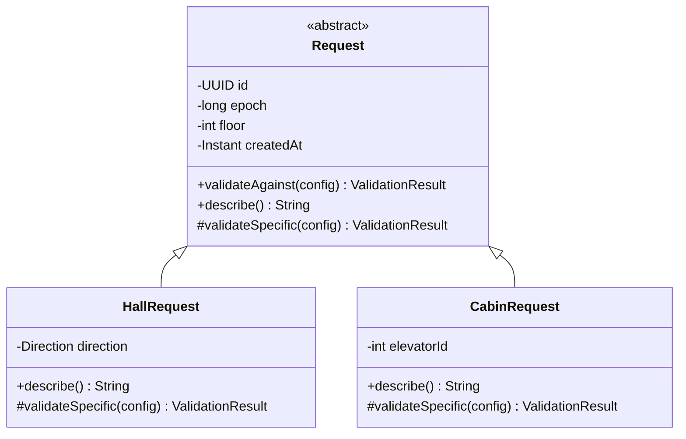

# T13 — Diseñar la herencia de solicitudes

- **Proyecto:** Elevator Manager.
- **Versión:** 0.1.0.
- **Fecha:** 2026-10-20, Guatemala.
- **Fase:** 2 — Crear carpetas y diseñar la arquitectura.
- **Estado:** diseño preparado y revisado; pendiente de incorporación y cierre por el usuario.
- **Base:** [arquitectura v0.2.0](../03-arquitectura.md), [decisiones D09, D17–D19 y D28](../02-decisiones.md) y enunciado.
- **Alcance:** diseño de la relación de herencia y del flujo polimórfico. La implementación Java corresponde a T18.

## 1. Objetivo y criterio de aceptación

Definir `Request`, `HallRequest`, `CabinRequest` y el comportamiento polimórfico que utilizará la aplicación. La relación «es una solicitud» debe ser válida y debe existir un flujo previsto que utilice referencias del tipo base para ambos subtipos.

La herencia representa dos clases de petición de servicio: llamar una cabina desde un piso y seleccionar un destino dentro de una cabina. No se usa herencia de ventanas o de hilos para justificar este requisito del enunciado.

## 2. Jerarquía y ubicación



El diagrama describe contratos; no es código Java implementado. Los tres tipos pertenecen a `com.elevatormanager.model.request`.

| Archivo futuro | Declaración prevista | Responsabilidad |
| --- | --- | --- |
| `src/main/java/com/elevatormanager/model/request/Request.java` | Clase pública abstracta. | Estado común inmutable y validación compartida. |
| `src/main/java/com/elevatormanager/model/request/HallRequest.java` | Clase pública final que extiende Request. | Recogida externa con dirección. |
| `src/main/java/com/elevatormanager/model/request/CabinRequest.java` | Clase pública final que extiende Request. | Destino interno de una cabina concreta. |

`Request` no es instanciable. Sus constructores serán protegidos y los subtipos invocarán el constructor base. Los campos serán privados y finales, accesibles mediante métodos de lectura y sin setters. Ningún subtipo volverá a declarar piso, identidad, época o fecha.

## 3. Datos comunes de Request

| Dato | Tipo Java previsto | Contrato |
| --- | --- | --- |
| `id` | `UUID` | Identidad de una solicitud lógica, no nula, estable desde su creación. |
| `epoch` | `long` | Generación capturada para esa solicitud; valor no negativo. No se cambia para reciclar solicitudes tras reset. |
| `floor` | `int` | Piso de recogida o destino, según subtipo; al menos 1. El máximo depende de la configuración. |
| `createdAt` | `Instant` | Instante no nulo de creación, recibido al construir para facilitar pruebas reproducibles. No mide duración del viaje. |

Una función de creación en la capa que transforma la entrada proporciona UUID, época y fecha. La GUI no elige la época. No hace falta una clase fábrica adicional si una función existente cubre esa responsabilidad. Los constructores reciben los valores explícitamente, sin leer el estado global.

Para solicitudes manuales, el controlador captura la época al serializar la admisión. Para archivos, el lector recibe la época capturada en RESET y construye las solicitudes del lote con ella. Antes de confirmar el lote, el controlador verifica de nuevo RESET y la misma época. Un reset invalida el lote y no se arregla actualizando sus objetos antiguos.

La configuración común de sesión (`SimulationConfig`) suministra N y P al validar. Los límites exactos y el propio tipo de configuración se implementan en T16; no se duplican como campos de cada solicitud.

## 4. Especialización de HallRequest

**Significado:** alguien situado en `floor` desea viajar hacia `direction`. No determina qué cabina lo recogerá.

| Elemento | Decisión |
| --- | --- |
| Campo propio | `direction`, de tipo `Direction`, no nulo; valores UP o DOWN. |
| Validación específica | UP requiere que el piso sea menor que P. DOWN requiere que sea mayor que 1. |
| Destinatario operativo | `ManagerWorker`, después de la admisión por el controlador. |
| Asignación de cabina | La decide el manejador usando la estrategia; no se almacena como propiedad mutable de la solicitud. |
| Ejemplo de descripción | «Llamada externa: piso 3, dirección UP». |
| Finalización | Inicio de una parada compatible confirmado por la cabina asignada. |

El ID de la cabina asignada pertenece al seguimiento del manejador y a los mensajes relacionados. Una llamada externa no se transforma en `CabinRequest` cuando se asigna.

## 5. Especialización de CabinRequest

**Significado:** se presionó un destino dentro de la cabina identificada por `elevatorId`.

| Elemento | Decisión |
| --- | --- |
| Campo propio | `elevatorId`, de tipo int, al menos 1. |
| Validación específica | El ID debe estar entre 1 y N; el piso debe cumplir la validación común 1..P. |
| Destinatario operativo | La cabina indicada, mediante controlador, protocolo y buzón. |
| Selección por estrategia | No se necesita: la cabina ya está determinada por la entrada. |
| Ejemplo de descripción | «Destino interno: elevador 2, piso 5». |
| Finalización | Inicio de la parada de servicio de ese destino, confirmado por esa cabina. |

No tiene campo direction: el usuario elige piso, y el movimiento depende del estado y recorrido de la cabina. Solicitar el piso actual puede ser válido; la decisión física se toma en el trabajador, no en esta validación.

## 6. Métodos y comportamiento polimórfico

| Operación | Definición prevista | Contrato |
| --- | --- | --- |
| Lectura de datos comunes | Métodos públicos finales `getId`, `getEpoch`, `getFloor`, `getCreatedAt`. | Devuelven datos inmutables; no entregan estado de trabajadores. |
| `validateAgainst` | Método público final en Request. | Valida el rango común de piso y combina su resultado con `validateSpecific`. No puede ser sobrescrito omitiendo reglas comunes. |
| `validateSpecific` | Método protegido abstracto; cada subtipo lo sobrescribe. | HallRequest valida sentido posible; CabinRequest valida existencia del ID en la configuración. |
| `describe` | Método público abstracto; cada subtipo lo sobrescribe. | Produce una descripción legible específica sin efectos laterales. |
| Lectura de dato propio | `getDirection` en HallRequest y `getElevatorId` en CabinRequest. | Solo existe en el subtipo que posee ese dato. |

`validateAgainst` aplica el patrón de método plantilla: la referencia tiene tipo `Request`, se ejecuta la regla común y Java despacha la parte específica al subtipo real. `describe` ofrece además despacho polimórfico directo.

No hay un método base `getElevatorId` que devuelva cero para externas, ni un `getDirection` que devuelva null para internas. Esos valores artificiales romperían el significado del contrato.

### 6.1 Resultado de validación

`ValidationResult` es un valor inmutable de dominio con una colección inmutable de errores; sin errores significa válido. Cada error contiene un código estable y una explicación. `ValidationResult` y sus errores se ubicarán en `model`, sin dependencias de Swing.

El orden del resultado es determinista: primero errores comunes, luego específicos. La validación específica evita mensajes engañosos derivados de un piso fuera de 1..P: en ese caso prevalece el error de rango de piso. No utiliza la estrategia ni consulta cabinas vivas.

### 6.2 Construcción, validación contextual y admisión

| Nivel | Qué comprueba | Tratamiento |
| --- | --- | --- |
| Conversión de entrada | Texto numérico, valores representables y dirección reconocida. | La capa de entrada devuelve error comprensible, con línea si procede de archivo. |
| Constructor | ID/fecha/dirección no nulos; época no negativa; piso e ID de cabina al menos 1. | Rechaza construcción con argumentos estructuralmente inválidos; no deja objetos parcialmente válidos. |
| `validateAgainst(config)` | Piso máximo, límites de sentido e ID máximo de cabina. | Devuelve ValidationResult, sin mutar la solicitud ni lanzar excepciones por un rechazo contextual normal. |
| Controlador y receptores | RUNNING o estado permitido de importación, época vigente, duplicados y disponibilidad operativa. | Resultado de admisión o respuesta del receptor conforme a T12. |

Null como configuración es un error de programación y se rechaza explícitamente. La configuración que se proporciona ya debe satisfacer T16. Las excepciones de construcción se traducen en errores de entrada en los adaptadores; no deben mostrarse como trazas al usuario por un dato escrito incorrectamente.

Una solicitud válida respecto al edificio no queda automáticamente admitida: por ejemplo, la misma solicitud manual se rechaza durante RESETTING.

## 7. Flujo real que utiliza el tipo base

### 7.1 Importador

1. El lector interpreta la línea y crea HallRequest o CabinRequest con contexto de época capturado.
2. Reúne una colección ordenada de `Request` que puede contener ambos subtipos.
3. Para cada referencia Request, ejecuta `validateAgainst(config)` y `describe()`.
4. La validación común y la especializada se aplican sin repetir en el lector las reglas de sentido o existencia de cabina.
5. Si hay errores de entrada o validación, devuelve los diagnósticos con línea y no confirma un lote parcial.
6. Si todo es válido, devuelve el lote preparado. El controlador revalida estado/época antes de sustituir el lote anterior.

El importador necesariamente reconoce el tipo al interpretar la sintaxis; ese reconocimiento no sustituye el comportamiento polimórfico posterior.

### 7.2 Controlador

1. Su frontera común de admisión recibe una referencia `Request`.
2. Aplica `validateAgainst(config)` y usa `describe()` para el resultado legible o registro.
3. Verifica estado global, época y duplicados funcionales.
4. Enruta según el subtipo: externa al manejador, interna a la cabina indicada.
5. Devuelve resultado de admisión; la asignación y atención se notifican posteriormente.

El enrutamiento puede distinguir explícitamente los dos subtipos, porque sus destinos son diferentes. No se añaden métodos de envío a Request: el dominio no conoce controlador, buzón, protocolo ni Swing. Tampoco se traslada la validación polimórfica a un bloque de comprobaciones de tipo.

## 8. Identidad, duplicados y concurrencia

| Concepto | Regla |
| --- | --- |
| Identidad lógica | UUID estable para correlacionar esa solicitud durante su seguimiento. |
| Duplicado funcional externo | Misma época, piso y sentido mientras la externa anterior siga activa. |
| Duplicado funcional interno | Misma época, cabina y piso mientras el destino anterior siga activo. |
| Duplicado de transporte | Repetición de un mensaje; lo trata el protocolo/receptor usando su identidad de mensaje. |
| Repetición después de servicio | Nueva solicitud con nuevo UUID, admisible si el estado lo permite. |
| Reset | Invalida las solicitudes de la época anterior; no cambia sus campos. |

En T18 se fijarán `equals` y `hashCode` como métodos finales en Request basados en UUID, de modo que los subtipos no cambien la semántica de identidad. La generación crea un UUID nuevo para cada nueva solicitud. Una reutilización de UUID con contenido distinto es una inconsistencia y debe rechazarse, no reemplazar silenciosamente la solicitud existente. La deduplicación funcional usa claves explícitas de la tabla y no `equals`.

Los objetos pueden compartirse entre hilos porque son inmutables. No contienen `assigned`, `completed`, `currentFloor`, temporizadores, colas ni referencias mutables a cabinas. El seguimiento mutable queda con el propietario definido en T12. La inmutabilidad de Request no convierte en segura una colección mutable de solicitudes: colas y publicación se concretan en T14.

`createdAt` sirve para trazabilidad. El tiempo transcurrido de movimiento/parada utiliza el reloj monotónico del simulador, no restas entre fechas de solicitudes.

## 9. Separación respecto al protocolo y logging

`describe()` produce texto para personas; no es el serializador del protocolo ni la sintaxis del archivo. El codificador/parser definido en 05 conserva esas responsabilidades. Tampoco se utiliza `toString()` como contrato de transporte.

Reset, Stop, Pause y Close son comandos de control, no subtipos de Request. Un comando interno del protocolo y una solicitud de servicio tienen identidades y ciclos de vida distintos. La solicitud permanece inmutable mientras el manejador y la cabina emiten eventos correlacionados.

Las implementaciones de Request no escriben archivos, no usan loggers para producir efectos durante la validación y no actualizan controles gráficos. El consumidor puede registrar el resultado de `describe()` junto con UUID, época e información estructurada del evento.

## 10. Casos de aceptación para T18

Estos casos son especificaciones para las pruebas futuras; no se declaran ejecutados en T13. Usar N=2 y P=5 salvo cuando se indique otro contexto.

| Caso | Resultado esperado |
| --- | --- |
| Crear Request directamente | No permitido: clase abstracta. |
| HallRequest en piso 3, UP | Validación contextual válida. |
| HallRequest en piso 5, UP | Error de sentido en último piso. |
| HallRequest en piso 1, DOWN | Error de sentido en primer piso. |
| CabinRequest de cabina 2 a piso 5 | Validación contextual válida. |
| CabinRequest de cabina 3 a piso 4 | Error de ID fuera del edificio configurado. |
| Solicitud con piso 6 | Objeto estructuralmente construible; validación contextual rechaza por rango. |
| Piso 0 o ID de cabina 0 | Constructor rechaza el argumento estructural. |
| Dirección nula, UUID nulo o fecha nula | Constructor rechaza el argumento. |
| Época negativa | Constructor rechaza el argumento. |
| P=1: HallRequest en piso 1, UP o DOWN | Ambas direcciones contextualmente inválidas. |
| P=1: CabinRequest de cabina existente a piso 1 | Contextualmente válida; el trabajador decide cómo servirla. |
| Colección Request con ambos subtipos | Se ejecutan validación especializada y descripción correspondientes a cada objeto. |
| Dos UUID distintos para misma llamada activa | No son iguales por identidad; el controlador detecta duplicado funcional. |
| Reenvío de mensaje para una solicitud | No crea por sí mismo una nueva solicitud ni duplica su servicio. |
| Solicitud válida de época anterior | Validación de edificio puede pasar; admisión la rechaza por época. |
| Lectura simultánea de una solicitud | Nadie puede modificar sus campos; sin dependencia de estado mutable global. |

## 11. Revisión y cierre de T13

| Criterio de la tarjeta | Resolución |
| --- | --- |
| Relación de herencia válida | Externa e interna son solicitudes de servicio; secciones 1–5. |
| Datos comunes sin duplicación | Request contiene identidad, época, piso y fecha; sección 3. |
| Comportamiento especializado útil | Validación contextual y descripción; sección 6. |
| Flujo previsto con referencias del tipo base | Importador y controlador; sección 7. |
| Dominio desacoplado y seguro para compartir | Inmutabilidad y ausencia de Swing/transportes; secciones 8–9. |
| Comprobación posterior concreta | Casos de aceptación de sección 10. |

Se revisó el diseño frente a las decisiones y contratos de T12. No se requieren cambios Java ni repetir Maven para esta tarea exclusivamente documental. Este documento desarrolla la sección 4 de la arquitectura y se conserva como detalle de diseño; no la reemplaza.

### Incorporación al proyecto

Guardar este archivo en `docs/diseno/T13-herencia-solicitudes.md`. Crear `docs/diseno` si todavía no existe. Desde PowerShell, en la raíz del proyecto:

```powershell
git diff --check
git status --short
```

El nuevo documento debe aparecer sin archivos Java modificados por esta entrega. Revisar el contenido desde el editor; al ser nuevo y no preparado, `git diff` no muestra todavía su texto. Una vez revisado, actualizar el estado del encabezado a `Terminada; diseño incorporado y revisado` y ejecutar:

```powershell
git add -- docs/diseno/T13-herencia-solicitudes.md
git diff --cached --check
git diff --cached --stat
git diff --cached -- docs/diseno/T13-herencia-solicitudes.md
```

Comprobar que el contenido preparado corresponde al diseño de T13. Después:

```powershell
git commit -m "T13: disenar herencia y polimorfismo de solicitudes"
git status --short
```

Mover T13 a Terminada tras incorporar y revisar el diseño. Próxima tarjeta: **T14 — Diseñar sincronización y estado publicado**. Esta tarea no completa T18.

## 12. Historial

| Versión | Fecha | Cambio |
| --- | --- | --- |
| 0.1.0 | 2026-10-20 | Diseño de jerarquía, contratos, inmutabilidad, identidad, validación y flujos polimórficos. |
